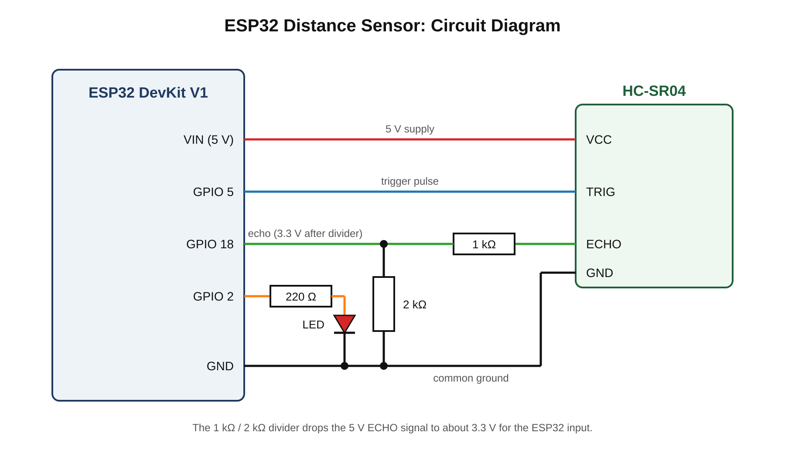

# ESP32 Distance Sensor

Measures distance with an HC-SR04 ultrasonic sensor and lights an LED when an object is closer than 20 cm. This is an example repo that shows how to lay out code, a circuit diagram and documents.

## Components

Full list with quantities: (docs/bill-of-materials.csv)

- ESP32 DevKit V1
- HC-SR04 ultrasonic sensor
- LED and 220 Ω resistor
- 1 kΩ and 2 kΩ resistors (voltage divider for the ECHO pin)

## Circuit Diagram



Editable version: [hardware/circuit-diagram.svg](hardware/circuit-diagram.svg)

## Pin Connections

| Component | Pin on component | ESP32 pin |
| --- | --- | --- |
| HC-SR04 | VCC | VIN (5 V) |
| HC-SR04 | GND | GND |
| HC-SR04 | TRIG | GPIO 5 |
| HC-SR04 | ECHO | GPIO 18 (through 1 kΩ / 2 kΩ divider) |
| LED | Anode (through 220 Ω) | GPIO 2 |
| LED | Cathode | GND |

## How to Run

1. Install the Arduino IDE and add ESP32 board support.
2. Open `code/main/main.ino`.
3. Select **ESP32 Dev Module** and the correct port.
4. Click **Upload**.
5. Open the Serial Monitor at 115200 baud to see the distance.

## Folder Structure

```
esp32-distance-sensor/
├── README.md
├── .gitignore
├── code/
│   └── main/
│       └── main.ino
├── hardware/
│   ├── circuit-diagram.png
│   └── circuit-diagram.svg
└── docs/
    └── bill-of-materials.csv
```
